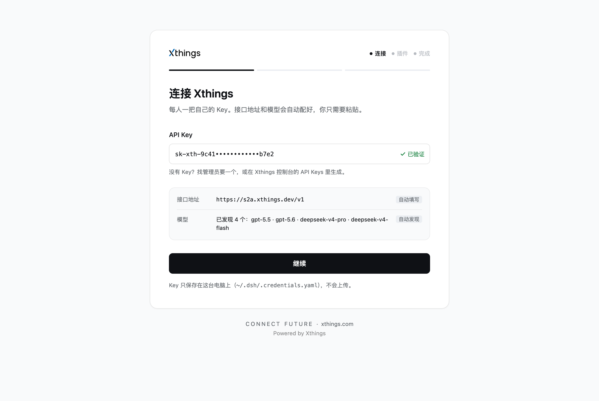
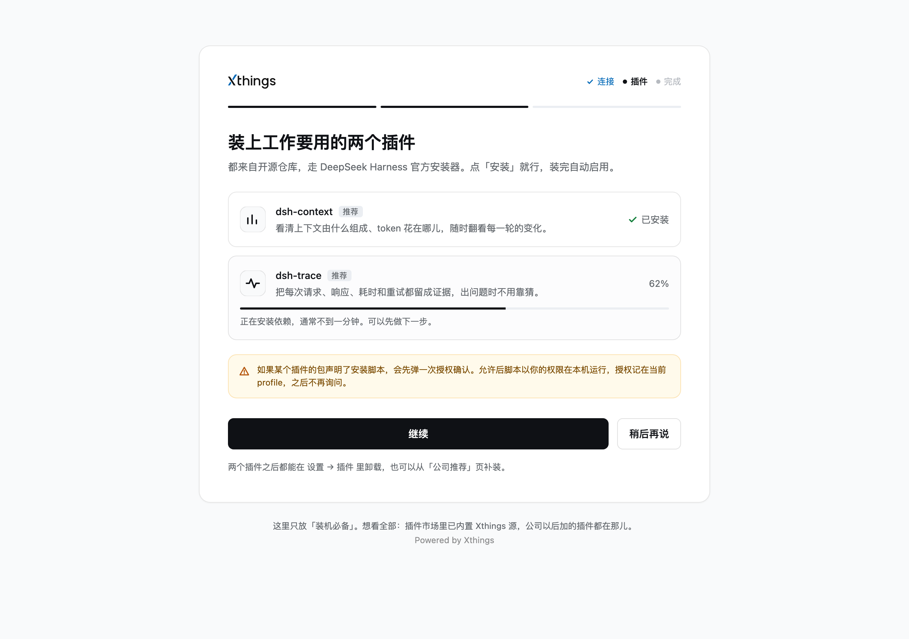
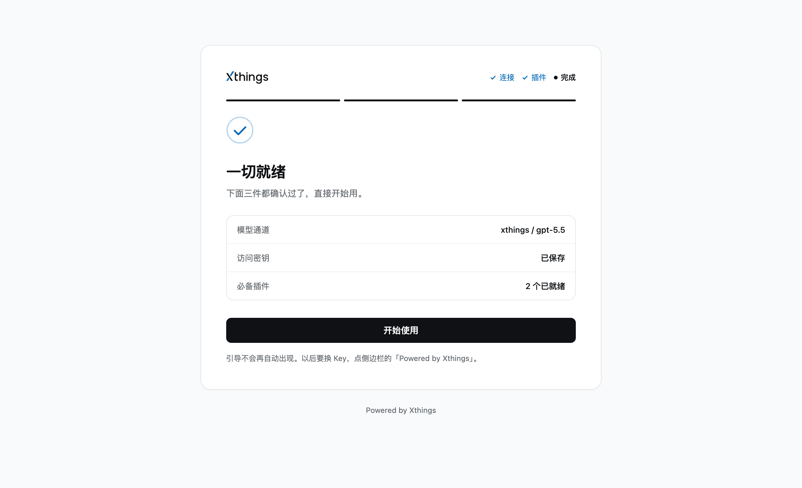
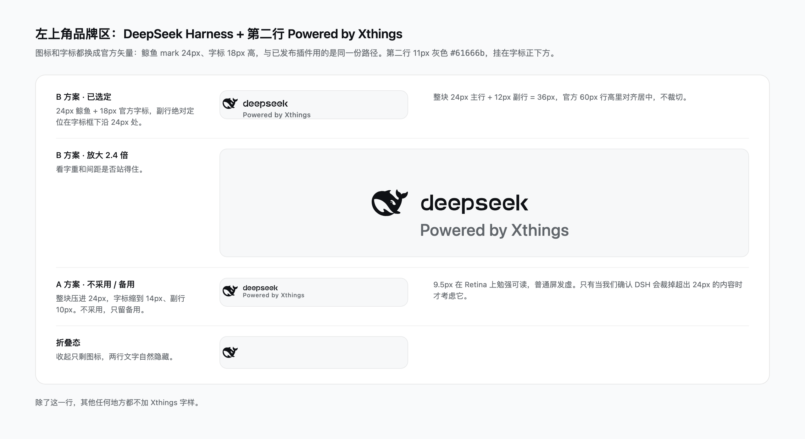
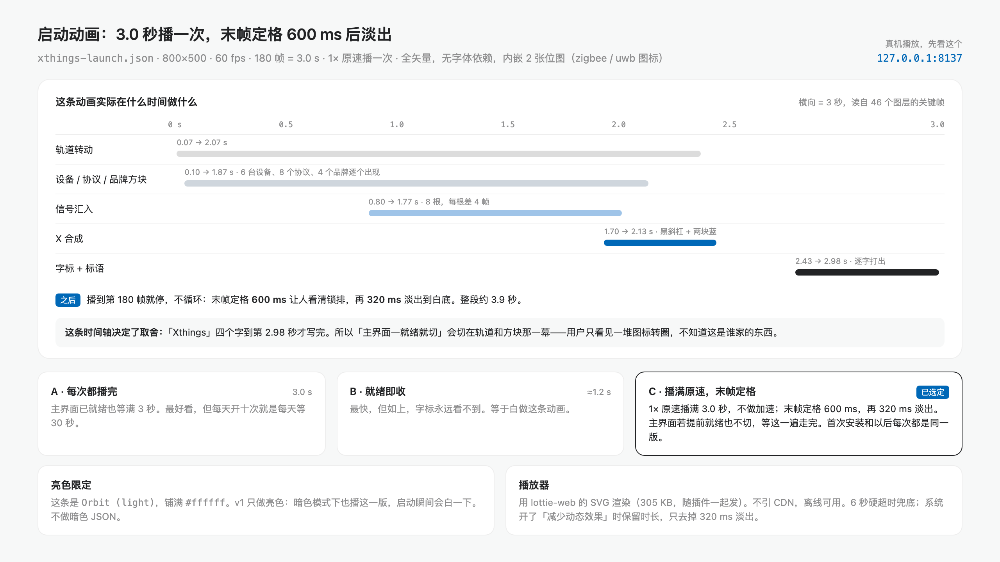
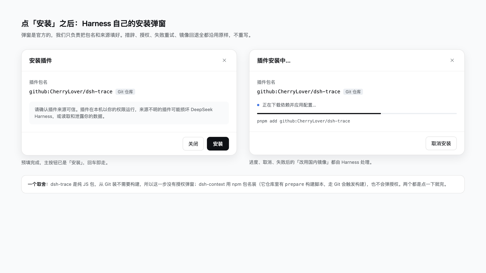

# @xthings/dsh-brand

Xthings 的 DeepSeek Harness 品牌插件。一个 bundle，三件事：

1. **启动动画** —— 用品牌动画替换默认启动画面，正常速度播完 3.0 秒再进入主界面。
2. **侧栏品牌** —— 保留官方鲸鱼图标和官方字标，在字标下面加一行 `Powered by Xthings`。
3. **首次配置向导** —— 检查 `xthings` 提供方是否存在；缺了就弹出向导，粘贴个人 Key 后自动写好 Base URL、存好凭据、加上插件源，再装两个必备插件。

## 效果预览

启动动画：1× 播满 3.0 秒（800×500 / 60fps / 180 帧），末帧定格 600 ms，再 320 ms 淡出。


首次配置向导的三步：

| 第一步 · 连接 | 第二步 · 插件 |
| --- | --- |
| [](docs/design/01-main.png) | [](docs/design/02-plugins.png) |

| 第三步 · 完成 | 侧栏品牌规格 |
| --- | --- |
| [](docs/design/03-done.png) | [](docs/design/04-brand.png) |

| 启动动画规格 | 宿主的安装弹窗（参照） |
| --- | --- |
| [](docs/design/05-splash.png) | [](docs/design/06-install.png) |

点图看原尺寸。GIF 和这六张图都是生成的：`docs/splash.gif` 由 `assets/launch.json` 逐帧渲染，
画板图由 `design/` 拍出来，改完画板跑一次 `node dev/make-design-shots.mjs` 就对齐了。

## 安装

同事机器上最省事的一条路：打开插件市场，选「Xthings DSH Plugins」这个源，在「装机必备」里点
**Xthings 品牌** 装上，重启 Harness。这一条走的就是 Harness 官方的安装通道，不用命令行。

命令行也可以：

```bash
# 本机开发（直接指向工作目录，改完刷新即可）
dsh plugin install link:/Users/jiangjiwei/Code/xthings-dsh-brand

# 同事机器（从市场索引里的同一个源装）
dsh plugin install git+https://github.com/CherryLover/xthings-dsh-brand.git

# 手上的目录
dsh plugin install file:/path/to/xthings-dsh-brand
```

装完重启 Harness 生效。第一次进主界面时会先播启动动画，播完才出配置向导。

## 首次配置向导

向导只在**缺少 `xthings` 提供方或缺少 Key** 时出现，第二台机器以外不会再打扰。

| 项目 | 值 |
| --- | --- |
| 提供方 id | `xthings` |
| Base URL | `https://s2a.xthings.dev/v1` |
| 凭据 | `XTHINGS_API_KEY`（系统凭据库，不写进任何配置文件） |
| 协议 | `openai-completions` |
| 模型列表 | 用 Key 请求 `GET /v1/models` 自动发现，失败时退回 `deepseek-chat` |

Key 是**每人一把**，只存在本机凭据库里。发版包里不含任何 Key。

向导第二步装的两个插件，走的是 Harness 官方的插件安装通道（`pluginManager.installBundle`），和手动点安装完全同一条路径：

- `dsh-context@0.81.2`（npm）
- `@local/dsh-trace`（git，锁定 commit `6d45f9c`）

已经装过的会被识别出来并跳过，不会覆盖现有依赖（尤其是本机 `link:` 形式的开发目录）。

## 插件源

向导会把公司插件源追加进 Harness 的插件市场（不动已有源）：

```
https://cherrylover.github.io/xthings-dsh-market/market.json
```

源本身在 [CherryLover/xthings-dsh-market](https://github.com/CherryLover/xthings-dsh-market)，加插件、改版本只需要动仓库里的 `market.json` 并推到 `main`，GitHub Pages 会自动更新，所有人下次打开插件市场就能看到。

## 实现要点

- 只往 loader 里插一行（`cordis.patch.yml` 的 `insert`），不 `override` 任何现有配置。loader 的 `config` 是整块替换、不做深合并，直接改会把别人的 provider 表（或插件源列表）冲掉，所以提供方和插件源都在运行时用 `configEditor.edit` / `pluginMarket.setIndexes` 写。
- 启动动画通过 `webserver/index-inject` 事件贡献四行（Lottie 构建、动画数据、样式、覆盖层脚本），Web 和 Electron 两条路径都走同一份注入表；不用 `tapIndex`，因为 Electron 只转发 `collectIndexInjections()` 的行。
- Lottie 构建必须原样内联成独立的 `<script>`：它自己会写 `globalThis.lottie`，包一层 `window.lottie = …` 会把结果覆盖成 `undefined`，动画就静默降级成静态字标。
- 动画数据以 `animationData` 形式内联，不走 `src`/`fetch` —— 打包后是 `file://`，没有可用的 HTTP 路由。
- 客户端半边（`client.js`）没有 RPC 通道，所以向导用同源 HTTP 打自己宿主半边的三条路由；Electron 会把非静态的 `app://` 请求带 cookie 转发给宿主，两条路径行为一致。

### 宿主路由

| 路由 | 用途 |
| --- | --- |
| `GET /xthings-brand/status` | 向导是否需要出现、提供方/凭据/插件/插件源现状 |
| `POST /xthings-brand/provision` | `{key}` → 校验、存凭据、写提供方、补插件源 |
| `POST /xthings-brand/install` | `{id}` → 装一个推荐插件（一次一个，已装则跳过） |

三条路由都做同源校验（`sec-fetch-site`、`origin`、`host`），跨站请求一律 403，响应统一 `no-store`。

## 设计画布

`design/` 是这六块画板的源文件（`project/canvas.json` + 每个画板一个 `.dc.html`），可以在支持
Design (canvas) 格式的编辑器里直接打开 `design/` 目录查看和改字：

| 画板 | 内容 |
| --- | --- |
| Main | 第一步：粘贴 Key |
| Step2-plugins | 第二步：两个必备插件 |
| Step3-done | 第三步：完成 |
| Brand | 侧栏品牌那两行的规格（官方锁排 + 副行，含放大和折叠态） |
| Splash | 启动动画的时间轴 |
| InstallDialog | 宿主自己的安装弹窗（不是我们的界面，只做参照） |

画板里的品牌图形都是 `design/assets/logo.svg` 那份官方矢量手工内联进去的，改的时候保持同一个来源。
`node dev/check-design.mjs` 会在 CI 里确认"登记的画板和实际文件对得上"。

## 开发

```bash
# 宿主半边：桩掉 Cordis 上下文，跑一遍三条路由和注入行（27 条断言）
node dev/test-host.mjs

# 启动动画：自包含测试页，file:// 或本地 http 都能开
./dev/serve.sh        # http://127.0.0.1:8138/dev/harness.html

# 重新生成 README 里的预览（需要本机 Chrome + ffmpeg）
node dev/make-preview.mjs        # → docs/splash.gif
node dev/make-design-shots.mjs   # → docs/design/*.png

# 画布自检：canvas.json 登记的画板和实际文件对不对得上
node dev/check-design.mjs
```

`dev/` 不进发布包（`package.json` 的 `files` 只列了运行时要用的东西）。

## 未做的事

- 暗色主题：目前只做了亮色，动画和向导都是白底。
- 卸载：删掉插件即可，提供方和 Key 会留在 profile 里，需要手动删除。
